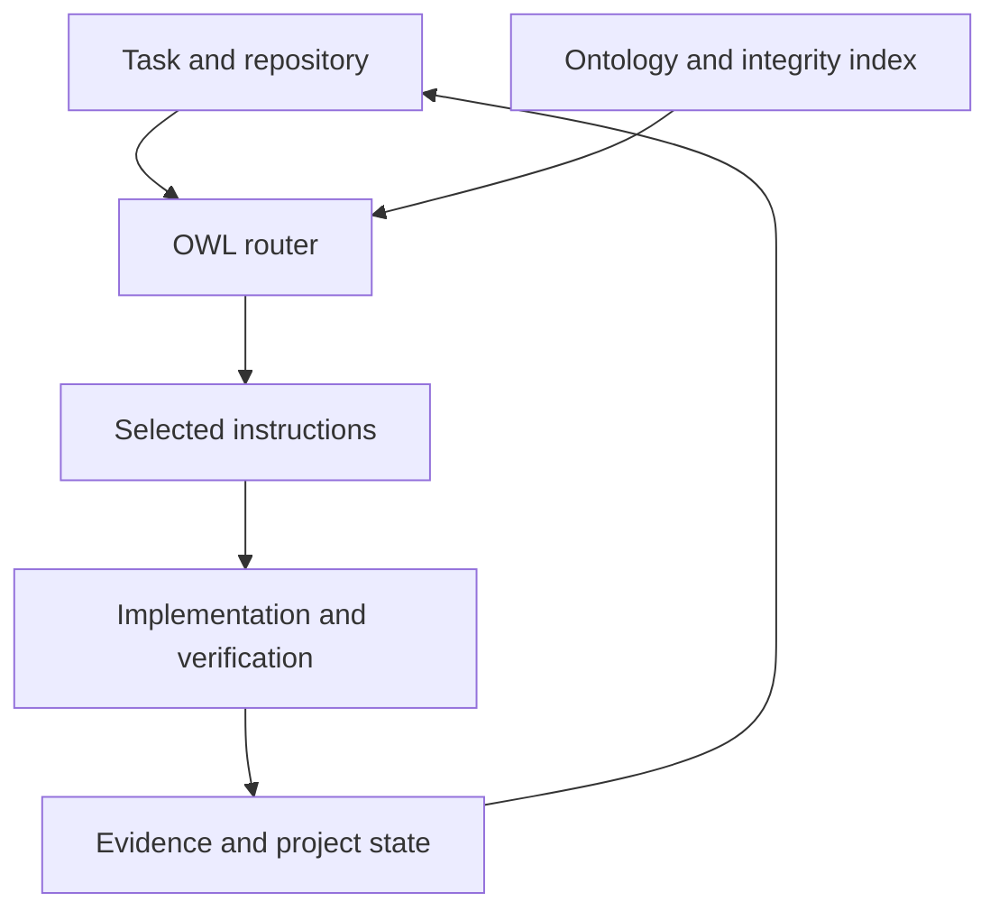

# OntoFlow FullStack Skills

**An ontology-guided collection for coordinating, building and verifying full-stack software.**

OntoFlow connects engineering tasks to the instructions, dependencies and evidence they require. The NEXUS coordinator reads the bundled OWL model, selects the relevant workflows for the current phase and preserves the contracts between architecture, APIs, data, UI and verification.

## 1. What the collection provides

- **12 installable packages** under [`skills/`](skills/), including one experimental placeholder.
- **30 entries in the NEXUS routing model:** 25 pinned engineering workflows and 5 personal engineering adapters.
- **11 task intents and 924 RDF statements** in the shipped ontology.
- Python routing, ontology maintenance scripts, behavioral tests and the blank Template scaffold.
- Selective instruction loading and persistent evidence contracts. Token savings are not expressed as a fixed percentage.

## 2. Choose an entry point

| Need | Start with | Responsibility |
| --- | --- | --- |
| Lead a complete project | [AutoTaska](skills/autotaska/SKILL.md) | Coordination, accepted contracts, dependencies and progress |
| Create project resources | [Project Creator](skills/project-creator/SKILL.md) | Project setup, repository and task dispatch |
| Manage visible department chats | [ChatGPT Task Creator](skills/chatgpt-task-creator/SKILL.md) | Bounded work in separate ChatGPT conversations |
| Build, review or migrate an application | [NEXUS](skills/nexus-full-stack/SKILL.md) | Ontology routing, implementation and evidence |
| Develop a Template application | [Full Stack](skills/full-stack/SKILL.md) | Coordinate architecture, backend, frontend and verification |
| Generate or inspect architecture | [Template Architecture](skills/template-architecture/SKILL.md) | Single-host architecture and blank scaffold |
| Implement backend behavior | [Template Backend](skills/template-backend/SKILL.md) | APIs, domain, persistence and authorization |
| Implement connected interfaces | [Template Frontend](skills/template-frontend/SKILL.md) | React/Vite, Blazor and API integration |
| Verify delivery | [Template Verification](skills/template-verification/SKILL.md) | Builds, migrations and behavior checks |
| Design a polished product UI | [Professional Interface Builder](skills/professional-interface-builder/SKILL.md) | Responsive interfaces, themes, RTL/LTR and role separation |
| Discover additional skills | [Find Skills](skills/find-skills/SKILL.md) | Skill discovery |
| Inspect the experimental placeholder | [Mahoer](skills/mahoer/SKILL.md) | No defined engineering workflow |

Choose one coordinator for each task. Read additional skill instructions only when selected by the task and its dependencies. The collection does not require every package to execute every request.

## 3. Understand the workflow

The agent first inspects the repository and current contracts. It classifies the task, runs the OWL router and reads the selected instructions. It then implements the requested slice, verifies real behavior and records evidence, blockers and the next task. A contract or schema change invalidates affected verification.



The router selects obligations; the agent executes them with available tools. It does not implement an application, remove host conversation history or certify deployment by itself.

## 4. Install and invoke

Clone the repository, then copy the required folders under `skills/` into your agent host's supported skills directory. Keep each package's `SKILL.md`, `agents/`, `assets/`, `references/` and `scripts/` together. Install personal dependencies by their exact skill names.

```bash
git clone https://github.com/asgmodel/ontoflow-fullstack-skills.git
cd ontoflow-fullstack-skills
```

Invocation is host-dependent. Use `$nexus-full-stack`, `@nexus-full-stack` or the corresponding skill picker when supported. The NEXUS display metadata uses **OntoFlow FullStack Skills** while its technical skill name remains `nexus-full-stack` for compatibility. Otherwise, ask the agent to read `skills/nexus-full-stack/SKILL.md` directly.

## 5. Run a realistic task

Example user request:

> Use $nexus-full-stack to implement an Arabic RTL design storefront in this repository. Support categories, public design pages, multiple images/videos/audio files per design, customization requests and an authenticated admin area. Inspect the existing stack, define the API and persistence contracts, build one complete slice at a time and verify protected writes, invalid input and persistence after reload. Report external services and unresolved setup separately.

Create a task JSON using [`task.schema.json`](skills/nexus-full-stack/assets/task.schema.json). For a routing demonstration, run the included example:

```bash
python skills/nexus-full-stack/scripts/route.py --task skills/nexus-full-stack/assets/example-task.json --packet
```

Routing uses Python 3.10+ and the standard library. Use `existing-stack` for a native application and `template-single-host` for a Template project. The example prompt describes a possible application request; this repository supplies skills and a blank scaffold, not a finished storefront.

## 6. Use the Template scaffold

The bundled Template uses a single ASP.NET Core host, Domain/Application/Infrastructure boundaries, EF Core SQL Server, React TypeScript/Vite and Blazor. Read its manifests and instructions for exact toolchain requirements.

```bash
python skills/template-architecture/scripts/scaffold.py --output ../MyProduct --name MyProduct
```

Generate into a new destination. The scaffold has no business data or external provider credentials. Existing projects retain their own stack. See [Skills and dependencies](docs/SKILLS_AND_DEPENDENCIES.md) for package boundaries and loading order.

## 7. Validate the ontology and router

```bash
python -m pip install -r skills/nexus-full-stack/scripts/requirements-maintenance.txt
python skills/nexus-full-stack/scripts/validate.py
python skills/nexus-full-stack/scripts/test_router.py
```

The current package passed ontology validation and **18 router tests**. These checks cover routing behavior, integrity, scope and evidence guards; they do not establish application runtime behavior or external deployment readiness.

The authoritative model is [`nexus.owl`](skills/nexus-full-stack/assets/nexus.owl). After changing it, run `scripts/compile_graph.py`, then validate and test. The Turtle model and graph index are generated projections. The router uses a constrained RDF/XML reader rather than a general OWL reasoner.

## 8. Navigate the source and attribution

| Path | Contents |
| --- | --- |
| [`skills/`](skills/) | Installable skill packages and their resources |
| [`skills/nexus-full-stack/assets/`](skills/nexus-full-stack/assets/) | Ontology, task schema, queries and graph projections |
| [`skills/nexus-full-stack/scripts/`](skills/nexus-full-stack/scripts/) | Router, validation, compilation, tests and benchmark |
| [`skills/nexus-full-stack/references/`](skills/nexus-full-stack/references/) | Execution contracts, adapters, provenance and pinned workflows |
| [`docs/`](docs/) | Collection dependency guide |
| [`catalog.json`](catalog.json) | Machine-readable package inventory |
| [`THIRD_PARTY_NOTICES.md`](THIRD_PARTY_NOTICES.md) | Licensing and provenance notices |

NEXUS preserves 25 workflows from Addy Osmani's agent-skills at the pinned source revision, with their MIT notice retained. Personal packages preserve their original instructions and have no newly assigned blanket license. Tools, account access, provider credentials and authorized deployment scope come from the host environment; installing the collection does not grant them.
