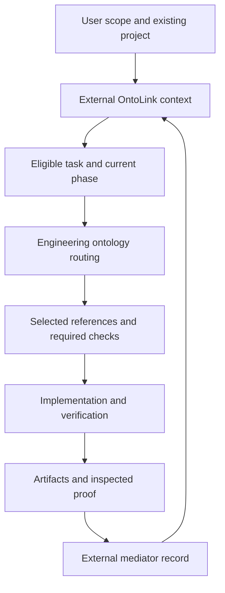

# Full Stack Engineering

**Ontology-guided software engineering, coordinated by your external OntoLink skill.**

Full Stack Engineering helps an agent turn accepted requirements into implemented, verified software. It connects architecture, backend, frontend, data, security, testing, delivery and operations through explicit contracts, task ownership and evidence.

The package uses your current **external OntoLink installation** to coordinate the project lifecycle and maintain its canonical state. The `skills/ontolink-skills/` directory contains loading instructions only. OntoLink continues to evolve in its own repository and can be refreshed independently across projects.

## Contents

- [Overview](#overview)
- [Engineering coverage](#engineering-coverage)
- [Repository structure](#repository-structure)
- [Requirements](#requirements)
- [Installation](#installation)
- [External OntoLink updates](#external-ontolink-updates)
- [Project workflow](#project-workflow)
- [Task routing](#task-routing)
- [Task ownership and handoffs](#task-ownership-and-handoffs)
- [Project state and evidence](#project-state-and-evidence)
- [Optional ASP.NET profile](#optional-aspnet-profile)
- [Validation and maintenance](#validation-and-maintenance)
- [Troubleshooting](#troubleshooting)
- [Documentation and attribution](#documentation-and-attribution)

## Overview

The system has three clear responsibilities:

| Component | Responsibility |
| --- | --- |
| External `ontolink-skills` | Coordinate lifecycle phases, task eligibility, canonical state and evidence-gated completion. |
| `software-engineering` | Select and apply the engineering knowledge required for the current eligible task. |
| Project repository | Hold application source, contracts, outcomes and the evidence supporting acceptance. |

One coordinator accepts work, one project graph records operational facts, and each task has an accountable owner. Existing applications retain their native framework, persistence model and directory conventions. The optional scaffold is available when its technology profile is deliberately selected.

The skill's technical name is `software-engineering`; its display name is **Full Stack Engineering**. Invoke `$software-engineering` when supported by your host, or ask the agent to read its installed `SKILL.md` directly.

## Engineering coverage

The engineering ontology routes **10 local references** and **25 attributed upstream workflows**. The agent loads the instructions relevant to the current task and its dependencies.

| Area | Scope | Reference |
| --- | --- | --- |
| Requirements | Scope, actors, constraints and checkable acceptance criteria | [Requirements](skills/software-engineering/references/requirements.md) |
| Architecture | Native boundaries, API contracts, decisions and integrated slices | [Architecture](skills/software-engineering/references/architecture.md) |
| Task distribution | Ownership, dependencies, write sets and handoffs | [Task assignment](skills/software-engineering/references/task-assignment.md) |
| Backend | Use cases, APIs, validation and server authorization | [Backend](skills/software-engineering/references/backend.md) |
| Frontend | Connected routes, interface states, accessibility and responsive behavior | [Frontend](skills/software-engineering/references/frontend.md) |
| Data | Persistence, transactions, concurrency and native migrations | [Data](skills/software-engineering/references/data.md) |
| Security | Identity, ownership, isolation, secrets and trust boundaries | [Security](skills/software-engineering/references/security.md) |
| Verification | Acceptance-based tests, current proofs and honest results | [Testing](skills/software-engineering/references/testing.md) |
| Delivery | Packaging, CI, authorized release and recovery | [Delivery](skills/software-engineering/references/delivery.md) |
| Operations | Diagnostic signals, blockers and evidence freshness | [Operations](skills/software-engineering/references/operations.md) |

## Repository structure

| Path | Purpose |
| --- | --- |
| [`skills/software-engineering/`](skills/software-engineering/SKILL.md) | The installable engineering skill, including its ontology, router, references and optional scaffold. |
| [`skills/ontolink-skills/`](skills/ontolink-skills/README.md) | Instructions to request, load and refresh the original external OntoLink skill. |
| [`scripts/`](scripts/) | Distribution validation, source inventory and test entrypoints. |
| [`tests/`](tests/) | Engineering, dependency-resolution and external-integration tests. |
| [`docs/architecture.md`](docs/architecture.md) | Authority boundaries, execution procedure and compatibility contract. |
| [`docs/file-inventory.md`](docs/file-inventory.md) | A complete list of necessary source files and their purposes. |
| [`catalog.json`](catalog.json) | The installed skill and its external dependency declaration. |
| [`MANIFEST.json`](MANIFEST.json) | Deterministic source paths and SHA-256 hashes. |

The OntoLink loader folder contains a single `README.md`. Its runtime, ontology and lifecycle phase packages remain in the external installation.

## Requirements

- **Python 3.10 or later** for engineering routing and dependency resolution. Normal execution uses the Python standard library.
- An agent host that can load skill instructions and access the target project.
- A current external installation of [`asgmodel/ontolink-skills`](https://github.com/asgmodel/ontolink-skills).
- Node.js compatible with your version of Skills CLI when using the `npx` installation commands.
- The target application's own build tools, database and provider access for the checks required by that application.

RDFLib and pySHACL are maintenance dependencies for ontology validation. Install them only when running the distribution's maintenance checks.

## Installation

Install Full Stack Engineering:

```sh
npx skills add https://github.com/asgmodel/ontoflow-fullstack-skills --skill software-engineering --global --yes
```

Request or install the original OntoLink skill separately:

```sh
npx skills add https://github.com/asgmodel/ontolink-skills --skill ontolink-skills --global --yes
```

`--global` makes the installation available across projects. Use `--agent` to target a particular supported host when needed. If your host provides its own skill manager, use that manager to request and refresh the same named skills.

A typical project request is:

> Use `$software-engineering` with the current external `ontolink-skills` to implement this feature. Inspect the existing stack, define the required contracts, assign bounded outcomes, verify the complete acceptance path and record current evidence.

## External OntoLink updates

At the beginning of each project session, the agent requests `ontolink-skills` by its exact identity and refreshes **that dependency alone** from its official source. After a successful refresh, it resolves the installation again and reads the current `SKILL.md`, contracts and selected phase instructions.

Dependency resolution supports an explicit `--coordinator-root`, the `ONTOLINK_SKILL_ROOT` environment variable, and known global host skill directories. It recognizes host-generated directory names and CLI-style symlinks by the skill's declared identity.

```sh
export ONTOLINK_SKILL_ROOT=/absolute/path/to/external/ontolink-skills
python <engineering-root>/scripts/dependency.py
```

The resolver reports the installed path. The host's skill manager performs installation and updates; the read-only router does not download or replace code. When a refresh fails, the agent reports the failure and the known freshness of the available installation. Existing project state and proof files remain in place.

See the [external loader instructions](skills/ontolink-skills/README.md) for the complete procedure.

## Project workflow

OntoLink coordinates the seven lifecycle phases. Full Stack Engineering consumes the current eligible task and supplies its engineering knowledge.

| Phase | Required outcome |
| --- | --- |
| Discovery | Scoped requirements and acceptance criteria |
| Architecture | Boundaries, contracts and decisions |
| Planning | Owned tasks, dependencies and verification obligations |
| Implementation | Completed work within the authorized scope |
| Verification | Current checks and acceptance evidence |
| Delivery | Accepted handoff and remaining prerequisites |
| Monitoring | Point-in-time signals, blockers and evidence freshness |



Execute bootstrap, context and record operations from the **current external coordinator directory**, following its current instructions. Preserve an explicitly configured canonical state path. The engineering ontology owns the compatibility mapping from external phase URIs to engineering stages; the external mediator owns eligibility and completion.

## Task routing

First, initialize or resume the project through the external coordinator. Then save a task input describing the inspected scope:

```json
{
  "intent": "feature",
  "profile": "existing-stack",
  "layers": ["frontend", "backend", "data"],
  "tags": ["auth", "data", "contract"]
}
```

Run the engineering router against the existing project state:

```sh
python <engineering-root>/scripts/route.py \
  --task <task-input.json> \
  --state <project>/knowledge.owl \
  --coordinator-root <current-external-ontolink-root>
```

Omit `phase` to derive the engineering stage from the live eligible task. Use `--focus-task <task-id>` to inspect an eligible subtask. Each invocation calls the external mediator anew, validates eligibility and emits selected references, suggested roles, required checks and change-impact information.

Use `existing-stack` for a native application. Select `aspnet-single-host` for the optional compatible scaffold. The input schema and example are available in [`assets/task.schema.json`](skills/software-engineering/assets/task.schema.json) and [`assets/example-task.json`](skills/software-engineering/assets/example-task.json).

For isolated catalog inspection, use `--catalog-only` with an explicit input phase. Catalog selection supplies guidance; project execution still requires current eligibility and the user's authorized scope.

## Task ownership and handoffs

Assign work by checkable outcome and dependency. Each task has one accountable owner and a linked contract describing its inputs, file ownership and acceptance conditions.

| Assignment field | Required information |
| --- | --- |
| Goal | Concrete behavior or review result |
| Inputs | Current requirement and contract IDs, plus relevant artifact hashes |
| Ownership | One accountable owner and an explicit file or module write set |
| Dependencies | Required predecessors and consumed artifacts |
| Outcome | Deliverable kind, path and acceptance criteria |
| Verification | The command or observed behavior required for acceptance |
| Handoff | Changes, proof, unresolved issues and the next consumer |

Dispatch tasks when predecessors are complete and blocking conditions are resolved. Parallel work requires permitted delegation and clear file ownership. Serialize overlapping writes or identify one integration owner. The coordinator reviews returned work and current proof before accepting completion.

## Project state and evidence

The canonical project graph is `knowledge.owl`, or the project's existing explicit state path. Generated OntoLink records and artifacts live beside that state.

| Path | Purpose |
| --- | --- |
| `knowledge.owl` | Requirements, tasks, relationships, decisions and operational state |
| `.ontolink/records/` | Submitted record payloads and revision receipts |
| `.ontolink/artifacts/` | Requirements, contracts, plans and generated text outcomes |
| `.ontolink/proofs/` | Verification logs and supporting proof files |
| `.ontolink/context.json` | Regenerated project context |
| `.ontolink/index/` | Optional navigational code index |

The external mediator accepts state writes with the observed revision. Completion requires the appropriate current outcome, inspected PASS evidence, matching artifact/proof hashes, completed prerequisites and resolved blockers. Changed requirements, contracts or artifacts reopen affected work and require relevant checks to run again.

## Optional ASP.NET profile

The bundled scaffold provides a single ASP.NET Core host with Domain, Application and Infrastructure boundaries, EF Core SQL Server, React TypeScript/Vite and Blazor.

Generate it into a new destination:

```sh
python <engineering-root>/scripts/scaffold.py --output <new-directory> --name MyProduct
```

Inspect the inherited manifests and available toolchains before building. The scaffold starts without business entities or invented authentication. File generation, compilation, database verification and application runtime behavior are separate outcomes. See the [ASP.NET profile](skills/software-engineering/references/aspnet-profile.md) for its contracts and validation steps.

## Validation and maintenance

From a source checkout, prepare the maintenance environment and validate the distribution:

```sh
python -m venv .venv
.venv/bin/python -m pip install -r skills/software-engineering/scripts/requirements-maintenance.txt
.venv/bin/python scripts/check.py
```

Run the behavioral and integration tests against an external OntoLink installation:

```sh
ONTOLINK_SKILL_ROOT=/absolute/path/to/external/ontolink-skills \
  .venv/bin/python scripts/run_tests.py
```

CI loads the current official OntoLink source into runner temporary storage **outside the repository checkout** and runs the checks on Python 3.10 and 3.12. The tests cover routing, eligibility, evidence guards, task dependencies, external resolution, live dependency changes, incompatible contexts and scaffold overwrite protection.

After changing the engineering ontology or referenced workflow content, regenerate the derived files and source manifest:

```sh
.venv/bin/python skills/software-engineering/scripts/compile_graph.py
python scripts/manifest.py --write
.venv/bin/python scripts/check.py
```

After documentation-only changes, refresh the manifest and run the source/link checks. Keep project state, proof logs, temporary environments and downloaded external dependencies outside the distribution inventory.

## Troubleshooting

| Condition | Required action |
| --- | --- |
| OntoLink is missing | Request or install the official external skill, then resolve its current path. |
| Multiple installations are found | Select the intended installation with `--coordinator-root` or `ONTOLINK_SKILL_ROOT`. |
| A dependency refresh fails | Report the failure and available version's known freshness; preserve project state. |
| The external context contract changes | Report the compatibility error and update the adapter or dependency deliberately. |
| No task is eligible | Inspect prerequisites and blockers through OntoLink before dispatching work. |
| A revision conflict occurs | Query current state and reconcile the record before retrying. |
| A tool or service is unavailable | Complete independent authorized work and report the specific unverified outcome. |

Application deployment and continuous monitoring require their actual tools, configuration and evidence. Selective retrieval may reduce unnecessary context; measured savings require actual usage data.

## Documentation and attribution

- [Skill operating instructions](skills/software-engineering/SKILL.md)
- [External OntoLink loader](skills/ontolink-skills/README.md)
- [Architecture and dependency contract](docs/architecture.md)
- [Complete necessary-file inventory](docs/file-inventory.md)
- [Source and attribution notices](THIRD_PARTY_NOTICES.md)

The retained upstream engineering workflows preserve their source identities and MIT notice. Personal engineering material retains its existing ownership; this refactor introduces no repository-wide license.
