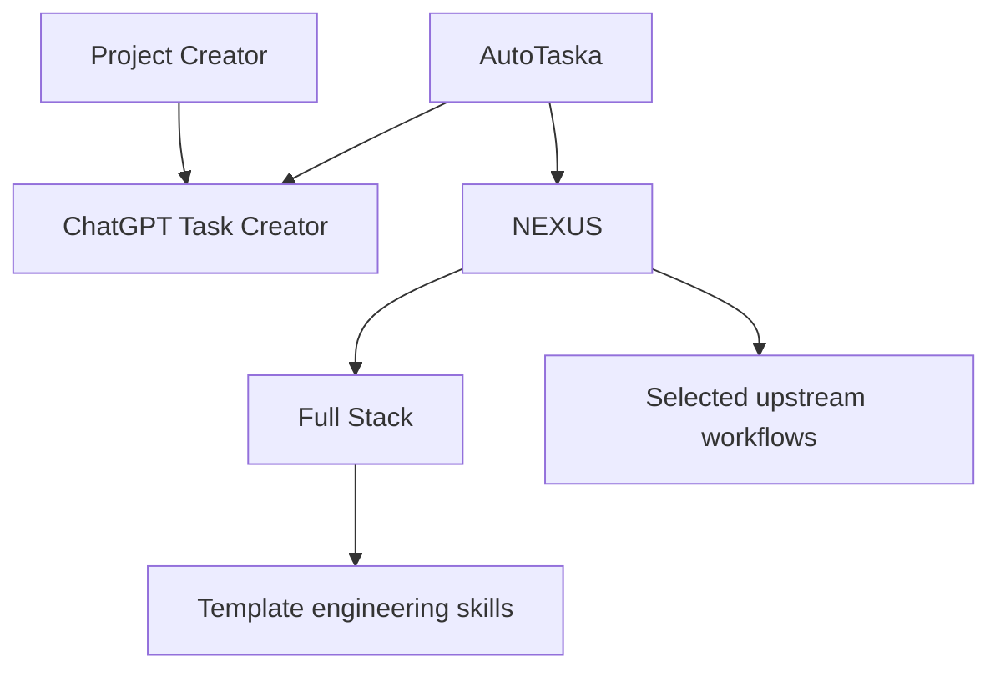

# OntoFlow FullStack Skills

OntoFlow is an ontology-guided engineering skill collection for planning, building and verifying complete software projects. The collection connects project setup, visible task coordination, ontology-guided full-stack delivery and specialized Template engineering workflows.

**12 skills · English repository documentation · Bundled NEXUS OWL ontology · Template scaffold included**

The repository name is **ontoflow-fullstack-skills**. See [Skills and dependencies](SKILLS_AND_DEPENDENCIES.md) for package boundaries and loading order.

## Download the complete project

[Download OntoFlow-FullStack-Skills.zip](OntoFlow-FullStack-Skills.zip)

The archive contains the complete extracted source tree: all 12 skill packages, ontology, scripts, references, Template scaffold and documentation. Extract `OntoFlow-FullStack-Skills/` before using the `skills/` paths and commands below. The repository root hosts the archive, catalog, manifest, dependency guide and notices. Older NEXUS archives are retained for history; use the OntoFlow archive for the accepted name.

## Skill catalog

| Area | Skill | Purpose |
| --- | --- | --- |
| Leadership | **AutoTaska** (`skills/autotaska/SKILL.md` in the ZIP) | Coordinate the complete engineering project, departments, dependencies and progress evidence. |
| Setup | **Project Creator** (`skills/project-creator/SKILL.md` in the ZIP) | Turn an idea into an actual ChatGPT project, GitHub repository and task conversations. |
| Coordination | **ChatGPT Task Creator** (`skills/chatgpt-task-creator/SKILL.md` in the ZIP) | Create and supervise separate visible ChatGPT conversations for bounded tasks. |
| Knowledge | **NEXUS Full Stack** (`skills/nexus-full-stack/SKILL.md` in the ZIP) | Read the OWL ontology to select workflows, context and verification obligations. |
| Engineering | **Full Stack** (`skills/full-stack/SKILL.md` in the ZIP) | Coordinate the four Template engineering skills across a complete feature or application. |
| Architecture | **Template Architecture** (`skills/template-architecture/SKILL.md` in the ZIP) | Scaffold and maintain the single-host modular ASP.NET Core architecture. |
| Backend | **Template Backend** (`skills/template-backend/SKILL.md` in the ZIP) | Implement API contracts, domain rules, EF Core persistence, authorization and integrations. |
| Frontend | **Template Frontend** (`skills/template-frontend/SKILL.md` in the ZIP) | Build React TypeScript/Vite and Blazor interfaces connected to the real backend. |
| Verification | **Template Verification** (`skills/template-verification/SKILL.md` in the ZIP) | Check architecture, behavior, builds, migrations and deployment evidence. |
| Interface | **Professional Interface Builder** (`skills/professional-interface-builder/SKILL.md` in the ZIP) | Design and integrate responsive interfaces, themes, RTL/LTR, roles and real API states. |
| Discovery | **Find Skills** (`skills/find-skills/SKILL.md` in the ZIP) | Discover relevant skills from the agent skill ecosystem. |
| Experimental | **Mahoer** (`skills/mahoer/SKILL.md` in the ZIP) | Preserve the existing personal placeholder; no defined engineering workflow yet. |

## Start with the right skill

Use **AutoTaska** for end-to-end project leadership. Use **Project Creator** for resource setup and initial task dispatch. Use **NEXUS** for application development or a targeted implementation, review, migration or release task. Use a specialized skill directly when the scope is already narrow.



Choose one coordinator for a task. Load required dependencies as needed; do not invoke every skill or create duplicate projects, repositories or conversations.

## Install and use

Copy the required folders from `skills/` into your agent host's supported skill directory. Keep each folder's `SKILL.md`, `references/`, `scripts/`, `assets/` and `agents/` together. Install dependencies by their exact skill names; platform-generated storage IDs are not required.

Invocation depends on the host. Use `@autotaska`, `@nexus-full-stack` or the host's `$skill-name` convention when supported. Otherwise, instruct the agent to read the relevant `SKILL.md` and apply it.

Example request:

> Use NEXUS to implement a complete application feature in the existing repository. Inspect the current stack and contracts, route only the affected phases and layers, implement the real API and UI behavior, and report verification evidence and any blocked external prerequisites.

Example for coordinated delivery:

> Use AutoTaska to coordinate this project from its brief through implementation and verification. Reuse existing resources, delegate bounded tasks only through available capabilities, maintain accepted contracts and show actual progress.

## NEXUS ontology and context routing

The authoritative model is **nexus.owl** (`skills/nexus-full-stack/assets/nexus.owl` in the ZIP). The shipped graph maps **30 skills**, **11 task intents** and **924 RDF statements**. It selects current-phase workflows, follows dependencies and propagates stale artifacts after contract or schema changes.

```bash
python skills/nexus-full-stack/scripts/route.py --task skills/nexus-full-stack/assets/example-task.json --packet
```

Routing requires Python 3.10 or newer and uses a constrained named-node RDF/XML reader. It reads OWL directly and checks the generated integrity projection and workflow hashes. It is not a general-purpose OWL reasoner.

Token efficiency comes from selective loading and resumable project state. A budget overflow does not silently drop required security or contract instructions. Static instruction-token measurements do not guarantee a fixed saving in total tokens, cost or task completion.

## Template stack

`template-architecture/assets/blank-project` contains the blank scaffold and its own development instructions. The stack uses one ASP.NET Core server, internal Domain/Application/Infrastructure boundaries, EF Core with SQL Server, React TypeScript/Vite under `ClientApp`, and Blazor in `Components`.

Generate a blank project in a new destination:

```bash
python skills/template-architecture/scripts/scaffold.py --output ../MyProduct --name MyProduct
```

The scaffold contains no business application, payment integration, identity provider credentials or populated database. Follow its manifests for actual framework requirements. Existing applications on other stacks retain their own technology and commands.

## Validation

Install maintenance dependencies and validate the NEXUS graph and router:

```bash
python -m pip install -r skills/nexus-full-stack/scripts/requirements-maintenance.txt
python skills/nexus-full-stack/scripts/validate.py
python skills/nexus-full-stack/scripts/test_router.py
```

The NEXUS suite includes 18 behavioral checks for scope, dependencies, security gates, live OWL reading, stale projections and evidence integrity. Repository packaging checks do not establish that external account creation, applications, deployments or integrations are working.

## Host capabilities

| Capability | Requirement |
| --- | --- |
| Read skill instructions | Agent access to local skill files |
| Run router and scaffold | Python and shell execution |
| Build generated applications | Framework/toolchain versions from the scaffold manifests |
| Create visible ChatGPT projects and conversations | Authenticated supported browser or project tools |
| Create and write GitHub repositories | Suitable authenticated GitHub tools or browser/CLI capabilities |
| Use external providers | Configured credentials and successful provider verification |

These skills provide procedures and bundled resources; they do not grant tools, account access or automatic execution capabilities. Visible ChatGPT conversations are distinct from internal subagents. Monitoring happens during active execution and resume unless a real automation is configured.

## Repository layout

- `skills/<skill-name>/`: independently readable skill packages and their resources.
- `catalog.json`: machine-readable skill inventory.
- `THIRD_PARTY_NOTICES.md`: provenance and redistribution notes.
- `.gitignore`: local build, cache and credential exclusions.

Original skill instructions are preserved, including Arabic instructions where present. Repository documentation is in English. See each skill's entry point for its actual operational contract.

## Attribution

NEXUS includes pinned workflows from [Addy Osmani's agent-skills](https://github.com/addyosmani/agent-skills), with the upstream MIT license retained. See [Third-party notices](THIRD_PARTY_NOTICES.md) and NEXUS source metadata for provenance. No blanket license is assigned to personal skills or other material with no verified license.
