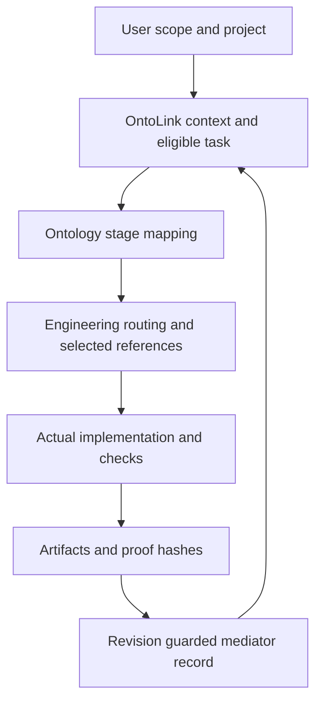

# Architecture and execution

## Authorities

| Authority | Canonical file | Responsibility |
| --- | --- | --- |
| Lifecycle model | `skills/ontolink-skills/assets/ontolink.owl` | Phase sequence, required outcomes, phase procedures and engineering-stage mapping |
| Project instance graph | `<project>/knowledge.owl` or explicit configured state | Actual requirements, contracts, actors, tasks, dependencies, artifacts, evidence and blockers |
| Engineering model | `skills/software-engineering/assets/engineering.owl` | Intent/profile/boundary routing, reference dependencies, roles and verification obligations |

Turtle mirrors and `engineering-index.json` are derived integrity projections.
Task JSON is an input payload; context and optional code indexes are generated
views. Only the revision-guarded mediator writes operational project state.
The two models serve separate responsibilities and do not compete for ownership.

## Lifecycle

| Phase | Required outcome | Work |
| --- | --- | --- |
| discover | requirements | Scope, actors, constraints and acceptance |
| design | contracts | Native architecture, APIs, data, identity and decisions |
| plan | plan | Owned outcomes, dependencies, file ownership and checks |
| build | implementation | Complete integrated slices within authorized scope |
| verify | verification | Actual behavior, security, data and UI checks as applicable |
| deliver | handoff | Accepted result, setup, receipts and remaining prerequisites |
| monitor | monitoring | Point-in-time signals, blockers and evidence freshness |

Read/review-only requests retain their scope through this lifecycle: an
implementation-phase artifact may document the completed review work; it does
not authorize application edits. A missing engineering recipe never advances
lifecycle. Missing tools/services remain explicit blockers or unverified claims.

## Task distribution

One coordinator accepts requirements, contracts and integration results. Assign
one accountable owner per checkable outcome. Every task records phase, required
outcome and dependencies in the graph; the linked plan describes its write set,
acceptance and checks. Register actual actors or explicitly declared planned roles.
Use descriptive role names: architecture, backend, data, frontend, verification
and delivery. Small tasks may share one owner.

Dispatch only eligible work. Parallel work requires session authorization,
independent contracts and nonoverlapping write sets, or a named integration
owner. An assignment or graph Message is not a live dispatch. Returned work must
be reviewed with current evidence before task closure. See the engineering
`references/task-assignment.md` contract for the exact assignment fields.

## Engineering knowledge

The engineering catalog contains 10 concise local references plus 25 attributed
upstream workflows. Five former personal adapters are consolidated into direct
references, with duplicate architecture coordination removed. The router reads
OWL and checks the derived workflow hashes before selecting context.

Native projects keep their framework, persistence, conventions and commands.
The optional `aspnet-single-host` profile retains the original single-host
ASP.NET/React/Blazor scaffold and its profile contracts. It is selected explicitly,
never used to replace an unrelated application's stack.

## Installation and updates

The installer validates the coordinator and engineering sibling before project
mutation. It stages both, preserves unrelated host instructions/skills/rules,
backs up replacements and restores managed files on installation failure. It
rejects invalid state, active locks, path traversal and symlink destinations.
An explicit existing state is reused without creating root `knowledge.owl`.
Backups are retained under `.ontolink/backups/`; they are not automatically pruned.
The installer refreshes project context but does not execute a software project.

Legacy independently installed packages are not deleted from user environments:
review local customizations and remove obsolete installations deliberately. In
this source distribution, obsolete top-level coordination/chat/placeholder
packages are removed and useful engineering content is consolidated.

## Validation limits

The constrained named-node RDF/XML parsers are not general OWL reasoners.
Evidence validation checks provenance and workflow conditions; humans/agents
must inspect whether a proof establishes the acceptance claim. No token-savings
percentage, background monitoring, live deployment or provider access is implied.
